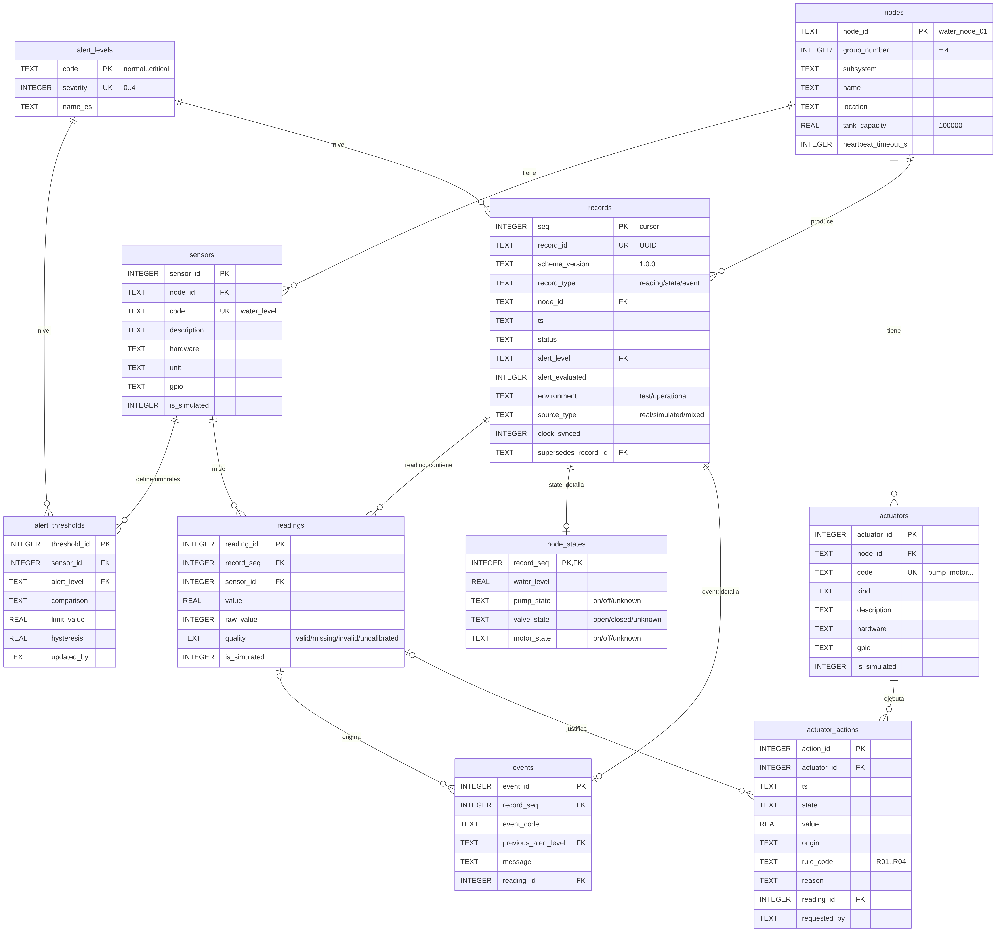
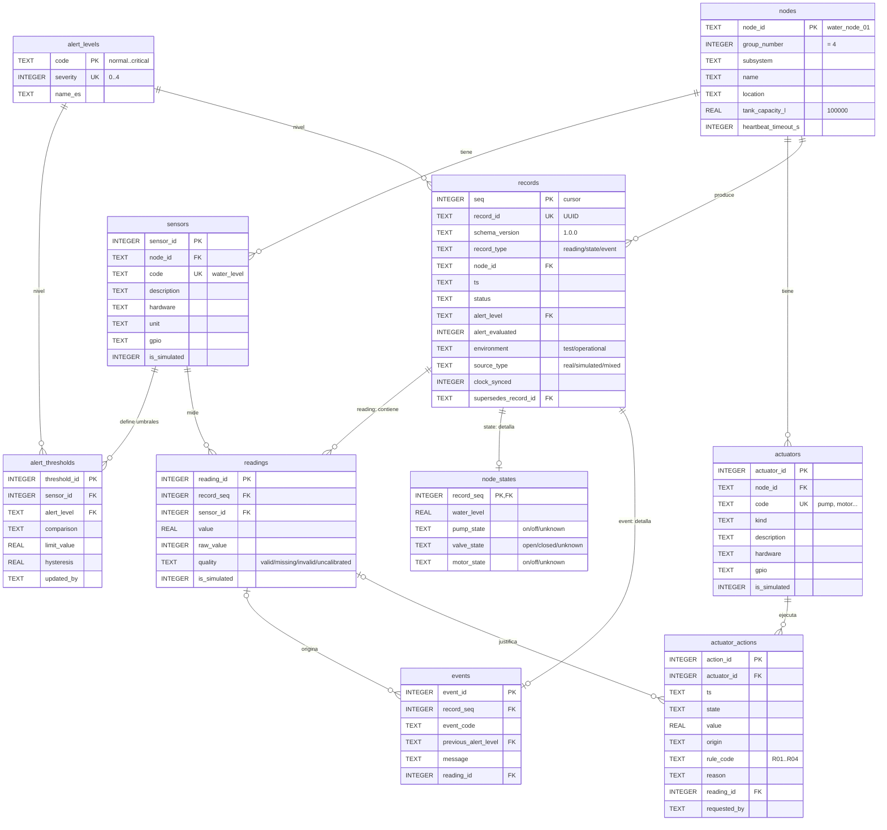

# 06 · Persistencia de datos

**Motor:** SQLite 3 (archivo único `backend/db/agua.db`, generado localmente)
**Scripts:** `backend/db/schema.sql` → `seed.sql` → `demo_data.sql` (opcional) · consultas de referencia en `queries.sql`
**Compatibilidad:** *Contrato de normalización e intercambio de datos* del Grupo 6, versión **1.0.0**.

## Diagrama entidad-relación



<details><summary>Fuente Mermaid (GitHub lo renderiza)</summary>


</details>

## Tablas

| Bloque | Tabla | Qué guarda |
|---|---|---|
| Configuración | `nodes` | El tanque (`water_node_01`) y la capacidad que representa (100.000 L) |
| | `sensors` | Lo que el ESP32 **lee**: el nivel de agua (`water_level`) |
| | `actuators` | Lo que el ESP32 **mueve**: bomba, válvula, motor, buzzer y display |
| | `alert_thresholds` | En qué % empieza cada nivel de alerta; editable desde la web |
| Catálogo | `alert_levels` | Escala común `normal → critical` con severidad 0–4 |
| Registros del contrato | `records` | El **sobre común** de cada registro compartido: `record_id`, tipo, fecha, estado, alerta y metadatos |
| | `readings` | Detalle de un registro `reading`: el valor de cada variable medida y su calidad |
| | `node_states` | Detalle de un registro `state`: nivel y estado de bomba, válvula y motor |
| | `events` | Detalle de un registro `event`: código, mensaje y lectura que lo originó |
| Uso interno | `actuator_actions` | Cada acción sobre un actuador y su motivo (justificación de decisiones) |

### Cómo se relacionan `records` y sus tablas hijas

Cada dato que se comparte con otros grupos es un **registro** del contrato. Todos los registros tienen los mismos campos comunes (el "sobre"), que se guardan **una sola vez** en `records`. El contenido específico se guarda en la tabla hija que corresponde a su tipo:

```
records (sobre común: record_id, timestamp, status, alert_level, metadata)
   ├── record_type = 'reading' → readings     (una fila por variable)
   ├── record_type = 'state'   → node_states
   └── record_type = 'event'   → events
```

Un trigger impide asociar una fila hija a un registro de otro tipo.

## Cómo responde a la consigna y al contrato

| Requisito | Lo resuelve |
|---|---|
| Recuperar información histórica (consigna 2.4) | `records` + `readings`, con índices por nodo, tipo y fecha |
| Analizar cambios (2.4) | Agregados por hora sobre `readings` |
| Consultar eventos (2.4) | `events` |
| Justificar decisiones (2.4) | `actuator_actions` con regla, motivo y lectura que la causó (`v_decision_trace`) |
| Control de operación y configuración (2.3) | `actuator_actions` con origen `manual_web`; `alert_thresholds` |
| `record_id` único y estable en reintentos (contrato) | UUID generado al insertar, `UNIQUE` |
| `record_type`, `schema_version` (contrato) | Columnas de `records` |
| `metadata.environment` (test / operational) | `records.environment` |
| `metadata.source_type` (real / simulated / mixed) | `records.source_type`; por variable en `readings.is_simulated` |
| `metadata.quality` (valid / missing / invalid / uncalibrated) | `readings.quality` |
| Lectura fallida como `null`, nunca 0 ni -999 | `CHECK`: si la calidad es `missing` o `invalid`, el valor **tiene** que ser `NULL` |
| `metadata.units` | `sensors.unit` con las unidades del catálogo (`%`, `L`) |
| Indicar qué capacidad representa el % de agua | `metadata.extensions.tank_capacity_l` |
| Correcciones con `supersedes_record_id` | `records.supersedes_record_id` |
| `GET /api/v1/status` | Vista `v_api_status` (último registro `state`, JSON listo) |
| `GET /api/v1/records?cursor=&limit=` | Vista `v_contract_records`; el cursor es `records.seq` (orden de inserción estable) |
| Historial recuperable tras una desconexión | Historial inmutable: no se modifica ni se borra |

## Decisiones de diseño

1. **SQLite.** Sugerido por la guía para prototipos: un solo archivo, sin servidor, SQL completo y funciones JSON incorporadas.
2. **Un "sobre" común (`records`) con tablas hijas por tipo.** El contrato define campos comunes para todos los registros y contenido distinto según el tipo. Guardar lo común una sola vez evita repetir columnas en tres tablas y da un orden único (`seq`) para paginar todo el historial.
3. **El JSON del contrato lo arma la base.** La vista `v_contract_records` devuelve cada registro con el formato exacto del contrato. El backend solo hace un `SELECT` y lo envía, sin riesgo de que cada endpoint arme el JSON distinto.
4. **Sensores y actuadores como filas.** Agregar un componente es un `INSERT`, no un cambio de estructura.
5. **Se describe la maqueta física, no la simulación.** Cada componente separa `description` (qué representa) de `hardware` (qué hay instalado); `is_simulated` marca los reemplazos.
6. **Trazabilidad obligatoria.** Una acción automática no se puede guardar sin regla y lectura; una manual, sin quién la pidió.
7. **Historial inmutable.** Triggers impiden modificar o borrar registros, lecturas, estados, eventos y acciones. Una corrección es un registro nuevo con `supersedes_record_id`.
8. **Triggers solo de integridad.** La lógica de control vive en el firmware y el backend.
9. **Fechas en UTC.** Se guardan con milisegundos y formato fijo (el orden de texto es el cronológico); la API las entrega como `2026-10-15T13:30:00Z`, el formato recomendado por el contrato.

## Componentes: maqueta física vs. simulación

| Componente físico | GPIO | Tabla · código | En Wokwi se representa con… | ¿Simulado? |
|---|---|---|---|---|
| Sensor de nivel de agua resistivo | 34 | `sensors` · `water_level` | Potenciómetro (Wokwi no tiene este sensor) | No |
| Bomba de agua | 26 | `actuators` · `pump` | LED naranja "BOMBA" | No |
| Servomotor (válvula) | 4 | `actuators` · `inlet_valve` | Servo | No |
| Motor | 27 | `actuators` · `motor` | LED verde "MOTOR" | No |
| Buzzer | 25 | `actuators` · `buzzer` | Buzzer | No |
| Display 7 segmentos | 13,14,18,19,21,22,23 | `actuators` · `level_display` | Display | No |

Escala: el firmware usa 0–9; la base guarda % → `nivel_% = dígito × 100 / 9`.

## Qué representa la maqueta

La maqueta es una **representación a escala del tanque de reserva de agua de la comunidad** de Caviahue–Copahue. La base registra la capacidad del tanque representado, **100.000 L** (valor de referencia para un pueblo chico, no un dato oficial), y la informa en `metadata.extensions.tank_capacity_l`. El porcentaje de nivel es el que mide la maqueta.

## Reglas de control (firmware)

| Código | Condición | Efecto | En `sketch.ino` |
|---|---|---|---|
| R01 | nivel ≤ 25 % | bomba ON, válvula 90° | `nivel <= 2` |
| R02 | nivel ≥ 85 % | bomba OFF, válvula 0° | `nivel >= 8` |
| R03 | nivel ≤ 15 % | motor ON, buzzer ON | `nivel <= 1` |
| R04 | nivel > 15 % | motor OFF, buzzer OFF | `!critico` |

Umbrales de alerta: bajo ≤ 65 %, medio ≤ 45 %, alto ≤ 25 %, crítico ≤ 15 % (histéresis 3 %).

## Qué guarda el backend por cada lectura del ESP32

1. Un registro `reading` en `records` + una fila en `readings`.
2. Si cambió el nivel de alerta: un registro `event` en `records` + una fila en `events`.
3. Si se movió un actuador: una fila en `actuator_actions`.
4. Un registro `state` en `records` + una fila en `node_states`. Así `GET /api/v1/status` siempre tiene un estado reciente y el Grupo 6 no marca el dato como desactualizado.

Mientras el sensor no esté calibrado, sus lecturas se guardan con `quality = 'uncalibrated'`. Los datos de prueba van con `environment = 'test'` y los de la maqueta en funcionamiento con `environment = 'operational'`.

## Uso

```bash
sqlite3 backend/db/agua.db < backend/db/schema.sql
sqlite3 backend/db/agua.db < backend/db/seed.sql
sqlite3 backend/db/agua.db < backend/db/demo_data.sql   # opcional: datos de prueba
```

> Cada conexión del backend debe ejecutar `PRAGMA foreign_keys = ON;` (SQLite lo trae desactivado).

## Limitaciones y mejoras

- El display refleja el nivel en todo momento; no se registra en `actuator_actions`.
- El firmware lee cada 100 ms; el backend debería guardar cada ~10 s (la frecuencia de consulta propuesta por el Grupo 6) o cuando el valor cambie.
- El sensor resistivo requiere calibración y se corroe si se alimenta en forma continua.
- `motor_state` no figura en el catálogo inicial del contrato: debe registrarse ante el Grupo 6 como variable propia del subsistema.
- No se modela aún la priorización entre consumidores (hay una sola válvula).
- El historial no se depura: para un uso prolongado haría falta una política de archivo.
